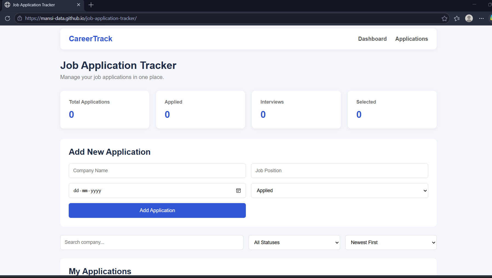

# CareerTrack – Job Application Tracker

CareerTrack is a responsive web application that helps users manage and track their job applications in one place.

## Features

- Add new job applications.
- Edit and update existing applications.
- Delete applications.
- Search applications by company name.
- Filter applications by status.
- Sort applications by application date.
- Dashboard displaying application statistics.
- Save application data using browser Local Storage.
- Responsive design for mobile and desktop screens.

## Technologies Used

- HTML5
- CSS3
- JavaScript
- Browser Local Storage

## Project Structure

```text
job-application-tracker/
│
├── index.html
├── style.css
├── script.js
└── README.md
```

## How to Run

1. Download or clone this repository.
2. Open the project folder.
3. Open `index.html` in your browser.
4. Start managing your job applications.

## Learning Outcomes

Through this project, I practised:

- DOM manipulation
- JavaScript event handling
- Array methods
- CRUD operations
- Local Storage
- Responsive web design
- Search, filtering and sorting logic

## Screenshots



## Author

Mansi Agrawal
